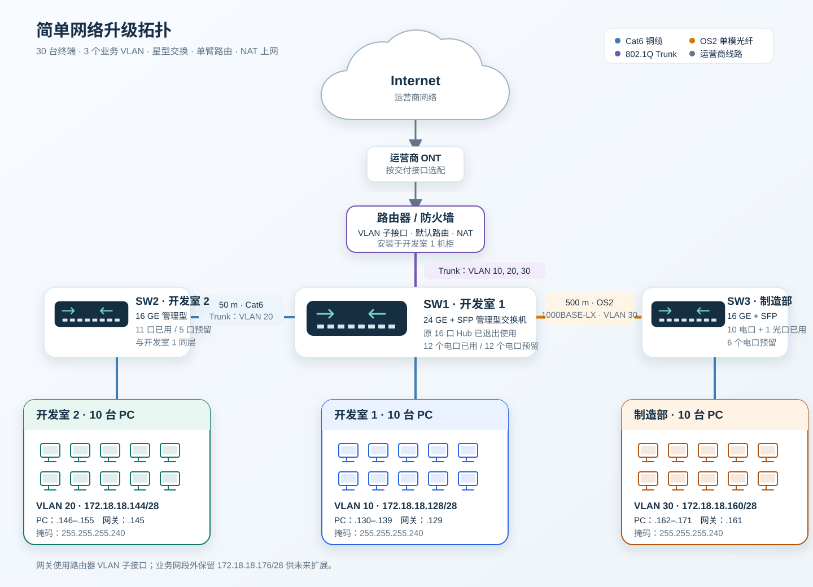

# 《计算机网络》实验二实验报告

## 简单网络的设计

| 项目 | 内容 |
|---|---|
| 学院 | 信息工程学院 |
| 课程 | 计算机网络 |
| 实验名称 | 实验二：简单网络的设计 |
| 班级 | 待填写 |
| 学号 | 待填写 |
| 姓名 | 待填写 |
| 日期 | 2026 年 11 月 19 日 |

> 本报告依据实验指导书完成方案设计与静态校验。实际设备配置及连通性测试需在实验设备或仿真环境中进行，本文不虚构上机测试结果。

## 一、实验目的

通过现有 10Base-T 网络的升级设计，掌握简单局域网的线缆选择、交换设备选型、设备部署、VLAN 划分、IP 地址规划、VLAN 间路由及 Internet 接入方法。

## 二、现状与设计要求

### 2.1 系统现状

- 开发室 1 位于开发部大楼二层，已有 10 台 PC，通过一台 16 口 10Base-T Hub 联网。
- 原终端线缆为 Cat5 UTP，原 Hub 为共享式设备，不能满足 VLAN 隔离和全双工交换需求。
- 新增开发室 2，有 10 台 PC，与开发室 1 同层，距离 50 m。
- 制造部有 10 台 PC，所在大楼距开发部大楼 500 m。
- 三个区域需要联网，并分别属于独立 VLAN。
- 可用地址为 `172.18.18.128/26`，并需考虑 Internet 接入。

### 2.2 设计目标

1. 将共享式 10 Mbit/s 网络升级为交换式千兆网络。
2. 保证 30 台 PC 接入，并为后续扩展保留端口和地址。
3. 通过 VLAN 隔离三个区域的二层广播域，通过路由器实现受控互通。
4. 合理使用给定 `/26` 地址块，不与其他网段重叠。
5. 支持通过运营商线路访问 Internet。

## 三、总体方案与网络拓扑

采用以开发室 1 为中心的星型交换网络。原 16 口 Hub 退出使用，三个区域分别部署支持 IEEE 802.1Q 的管理型交换机。开发室 2 通过铜缆上联开发室 1，制造部通过楼间单模光纤上联开发室 1。路由器部署在开发室 1 机柜，通过单臂路由提供三个 VLAN 的网关，并通过 WAN 口连接运营商线路。

设计要点：

- 终端端口配置为对应 VLAN 的 Access 口。
- 开发室 1 至路由器端口为 Trunk，仅允许 VLAN 10、20、30。
- 开发室 1 至开发室 2 的上联仅允许 VLAN 20。
- 开发室 1 至制造部的光纤上联仅允许 VLAN 30。
- 限制 Trunk 的 allowed VLAN，减少无关广播流量和误配置影响。

## 四、连接线缆的选择及理由

| 链路 | 选择 | 理由 |
|---|---|---|
| PC 至各房间交换机 | Cat6 U/UTP，RJ45 | 支持 1000BASE-T，兼容现有终端，便于施工与维护。永久链路控制在 90 m 内，完整信道不超过 100 m。 |
| 开发室 1 至开发室 2 | Cat6 U/UTP | 两室同层且标称距离 50 m，低于铜缆以太网 100 m 信道限制；实际走线应预留桥架弯曲和跳线长度并测试合格。 |
| 开发室 1 至制造部 | OS2 单模光纤，两端使用匹配的 1000BASE-LX SFP | 500 m 远超铜缆 100 m 限制。单模光纤满足楼间距离，抗工业电磁干扰，并可降低雷击和楼间地电位差带来的风险。室外段按环境选用铠装光缆，配套终端盒、尾纤和跳纤。 |
| 路由器至开发室 1 交换机 | Cat6 U/UTP | 距离短，使用千兆电口即可承载三个 VLAN 的 Trunk 流量。 |
| 运营商 ONT 至路由器 WAN | 按运营商交付接口选用 Cat6 或光纤 | ONT/光猫由运营商提供或兼容其线路，路由器 WAN 类型须与交付接口一致。 |

原有 Cat5 线缆可在通过链路认证后作为 100BASE-TX 过渡使用，但本方案的新骨干和新增接入链路统一采用 Cat6，不对旧线缆的千兆性能作未经测试的保证。

## 五、增加的设备、安装位置与端口预算

| 设备 | 数量 | 安装位置 | 端口配置与使用情况 |
|---|---:|---|---|
| 管理型交换机 SW1 | 1 | 开发室 1 机柜 | 至少 24 个 GE 电口和 1 个 SFP 光口。10 口接 PC，1 口接 SW2，1 口接路由器，共使用 12 个电口；1 个 SFP 接 SW3；剩余 12 个电口。替换原 Hub。 |
| 管理型交换机 SW2 | 1 | 开发室 2 机柜或信息箱 | 至少 16 个 GE 电口。10 口接 PC，1 口上联 SW1，剩余 5 口。 |
| 管理型交换机 SW3 | 1 | 制造部机柜或信息箱 | 至少 16 个 GE 电口和 1 个 SFP 光口。10 口接 PC，1 个 SFP 上联 SW1，剩余 6 个电口。 |
| 千兆路由器或防火墙 | 1 | 开发室 1 机柜 | 至少 2 个 GE。LAN 口作为 VLAN Trunk，WAN 口接运营商 ONT/线路；支持 802.1Q 子接口、NAT/PAT、静态路由和 ACL。 |
| 1000BASE-LX 单模 SFP | 2 | SW1 与 SW3 各 1 个 | 两端模块波长、单模类型和传输距离必须匹配。 |
| 运营商 ONT/光猫及光纤终端配件 | 按需 | 开发室 1 运营商进线处、两栋建筑光缆终端处 | ONT 由运营商提供或按其要求选配；楼间光缆两端配置终端盒、尾纤、适配器及跳纤。 |

### 5.1 交换机端口分配

| 设备 | 端口 | 连接对象 | 端口模式 |
|---|---|---|---|
| SW1 | GE1/0/1–GE1/0/10 | 开发室 1 的 10 台 PC | Access VLAN 10 |
| SW1 | GE1/0/11 | SW2 GE0/11 | Trunk，仅允许 VLAN 20 |
| SW1 | GE1/0/12 | 路由器 LAN GE0/1 | Trunk，仅允许 VLAN 10、20、30 |
| SW1 | SFP1/0/25 | SW3 SFP0/17 | Trunk，仅允许 VLAN 30 |
| SW2 | GE0/1–GE0/10 | 开发室 2 的 10 台 PC | Access VLAN 20 |
| SW2 | GE0/11 | SW1 GE1/0/11 | Trunk，仅允许 VLAN 20 |
| SW3 | GE0/1–GE0/10 | 制造部的 10 台 PC | Access VLAN 30 |
| SW3 | SFP0/17 | SW1 SFP1/0/25 | Trunk，仅允许 VLAN 30 |

## 六、Internet 接入设计

在开发室 1 机柜增加一台支持 VLAN 子接口和 NAT 的千兆路由器或防火墙。LAN 口连接 SW1 的 Trunk 口，WAN 口连接运营商 ONT 或交付线路。若运营商直接提供以太网交付，可不另配 ONT。

路由器逻辑配置如下：

1. 在 LAN 物理口下建立 VLAN 10、20、30 三个 802.1Q 子接口，分别使用表 7-1 中的网关地址。
2. WAN 地址、默认网关及 DNS 以运营商实际分配参数为准，可使用 DHCP 或静态配置。
3. 配置指向运营商下一跳的默认路由，使三个内网均可访问 Internet。
4. 对 `172.18.18.128/28`、`172.18.18.144/28`、`172.18.18.160/28` 的出站流量执行源 NAT/PAT，转换为 WAN 地址。
5. 配置基本安全策略：仅允许内网主动发起的外访及对应返回流量，WAN 侧管理默认关闭；跨 VLAN 访问按实际业务需求增加 ACL。

## 七、VLAN 与 IP 地址规划

### 7.1 划分方法

给定地址块 `172.18.18.128/26` 的范围是 `172.18.18.128–172.18.18.191`，共有 64 个地址。三个区域各有 10 台 PC，并且每个区域还需要 1 个网关地址。

选择 `/28`（掩码 `255.255.255.240`）进行等长子网划分：每个子网有 16 个地址，其中 14 个可用，能够容纳 10 台 PC、1 个网关和 3 个备用地址。一个 `/26` 恰好可划分为四个连续 `/28`，使用其中三个，第四个保留给未来扩展。

### 7.2 地址分配表

| VLAN | 区域 | 网络地址/前缀 | 子网掩码 | 网关 | 10 台 PC 地址 | 广播地址 | 备用可用地址 |
|---:|---|---|---|---|---|---|---|
| 10 | 开发室 1 | `172.18.18.128/28` | `255.255.255.240` | `172.18.18.129` | `172.18.18.130–172.18.18.139` | `172.18.18.143` | `172.18.18.140–172.18.18.142` |
| 20 | 开发室 2 | `172.18.18.144/28` | `255.255.255.240` | `172.18.18.145` | `172.18.18.146–172.18.18.155` | `172.18.18.159` | `172.18.18.156–172.18.18.158` |
| 30 | 制造部 | `172.18.18.160/28` | `255.255.255.240` | `172.18.18.161` | `172.18.18.162–172.18.18.171` | `172.18.18.175` | `172.18.18.172–172.18.18.174` |
| 保留 | 未来扩展 | `172.18.18.176/28` | `255.255.255.240` | 未分配 | 未分配 | `172.18.18.191` | `172.18.18.177–172.18.18.190` |

各 PC 的默认网关填写所属 VLAN 的网关，DNS 使用单位内部 DNS 或运营商提供的 DNS。交换机管理地址不属于题目强制项；如需带内管理，应从相应网段的备用地址中另行分配并更新本表，不得与 PC 或网关重复。

### 7.3 逐台 PC 地址表

| 区域 | PC 编号 | IP 地址 | 默认网关 |
|---|---|---:|---|
| 开发室 1 | PC-01 至 PC-10 | `172.18.18.130`、`131`、`132`、`133`、`134`、`135`、`136`、`137`、`138`、`139` | `172.18.18.129` |
| 开发室 2 | PC-01 至 PC-10 | `172.18.18.146`、`147`、`148`、`149`、`150`、`151`、`152`、`153`、`154`、`155` | `172.18.18.145` |
| 制造部 | PC-01 至 PC-10 | `172.18.18.162`、`163`、`164`、`165`、`166`、`167`、`168`、`169`、`170`、`171` | `172.18.18.161` |

## 八、VLAN 间路由与数据转发

采用单臂路由，无需额外占用一个路由器与三层交换机之间的传输子网，因此能够完整保留第四个 `/28`。

以开发室 1 的 PC 访问制造部 PC 为例：

1. 源 PC 判断目的地址不在本子网，将数据帧发送给 VLAN 10 网关 `172.18.18.129`。
2. SW1 给帧添加 VLAN 10 标签，经 Trunk 送往路由器 VLAN 10 子接口。
3. 路由器查询路由表，目的 `172.18.18.160/28` 是 VLAN 30 子接口的直连网络。
4. 路由器以 VLAN 30 标签把帧送回 SW1，SW1 经只允许 VLAN 30 的光纤 Trunk 转发给 SW3。
5. SW3 从目标 Access 口发出无标签帧，目的 PC 接收。

访问 Internet 时，路由器先完成路由转发，再将内部源地址转换为 WAN 侧地址；返回流量依据 NAT 会话转回内网。

## 九、验证方案与当前状态

| 验证项目 | 方法 | 预期结果 | 当前状态 |
|---|---|---|---|
| 地址规划 | 使用子网计算检查网络、网关、PC、广播地址 | 三个业务子网不重叠且均位于原 `/26` 内，每个子网容纳 10 台 PC | 静态检查通过 |
| 同 VLAN 通信 | 同房间两台 PC 互相 `ping` | 能收到回复，无需经过路由器 | 待上机验证 |
| 网关通信 | 各 VLAN 的 PC `ping` 本 VLAN 网关 | 均能收到网关回复 | 待上机验证 |
| 跨 VLAN 通信 | 开发室 1 PC `ping` 开发室 2、制造部 PC | 默认策略下可互通；施加 ACL 后仅允许的流量通过 | 待上机验证 |
| Trunk 检查 | 查看接口模式、本征 VLAN 和 allowed VLAN | 与第 5.1 节一致，不存在多余 VLAN | 待上机验证 |
| Internet 与 NAT | 使用 `tracert`/`traceroute`、访问公网并查看 NAT 表 | 默认路由有效，三个内网均转换为 WAN 地址 | 待运营商参数及上机验证 |
| 链路检查 | 铜缆认证、光功率和接口误码检查 | 铜缆信道合格，光模块收发光正常，无误码持续增长 | 待现场验证 |

## 十、设计过程中遇到的问题及解决办法

| 问题 | 原因分析 | 解决办法 |
|---|---|---|
| 原 Hub 无法直接满足三个 VLAN 的要求 | Hub 在物理层重复转发信号，所有端口共享冲突域，不能识别 802.1Q VLAN 标签 | 用管理型交换机替换 Hub，终端使用 Access 口，设备间按业务配置 Trunk |
| 500 m 楼间链路不能使用普通铜缆 | 1000BASE-T 等铜缆以太网信道通常限制为 100 m，且楼间存在电磁干扰和地电位差 | 改用 OS2 单模光纤与匹配的 1000BASE-LX SFP，并完善两端光纤终端和室外防护 |
| `/26` 不能划分为三个 `/27` | 一个 `/26` 只有 64 个地址，而三个 `/27` 共需 96 个地址 | 根据每个区域“10 台 PC + 1 个网关”的实际需求改用 `/28`，每个子网有 14 个可用地址 |
| 若采用三层交换机加独立传输网段，会额外消耗地址 | 题目只给出一个 `/26`，还需为三个业务 VLAN 留足容量 | 使用路由器 LAN 子接口进行单臂路由，避免独立传输网段，完整保留第四个 `/28` |
| Trunk 放通全部 VLAN 会扩大广播和误配置影响 | 开发室 2 只需 VLAN 20，制造部只需 VLAN 30 | 在各上联口配置最小 allowed VLAN 集合，并逐端口核对 |

## 十一、实验总结

本方案将原共享式 10Base-T 网络升级为分区域、可管理的交换式网络。铜缆与光纤按距离和环境合理选择，三台交换机满足 30 台 PC 接入并保留扩展端口；三个 `/28` 子网分别对应 VLAN 10、20、30，地址边界清晰且无重叠；单臂路由和 NAT 实现了 VLAN 间通信及 Internet 接入，同时保留了第四个 `/28` 供后续扩展。后续需依据真实设备型号将 `config/` 中的逻辑模板转换为具体命令，并按第九节完成上机验证。

## 十二、附件

- [网络拓扑图](../assets/topology.svg)
- [交换机逻辑配置模板](../config/switches.txt)
- [路由器逻辑配置模板](../config/router.txt)
- [项目运行与部署说明](../README.md)
